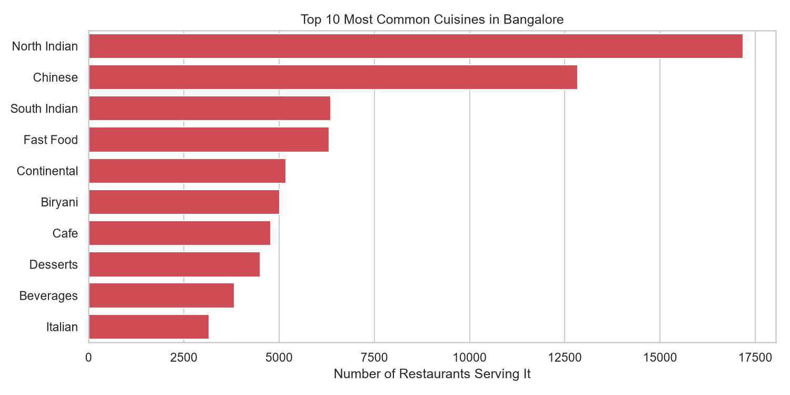
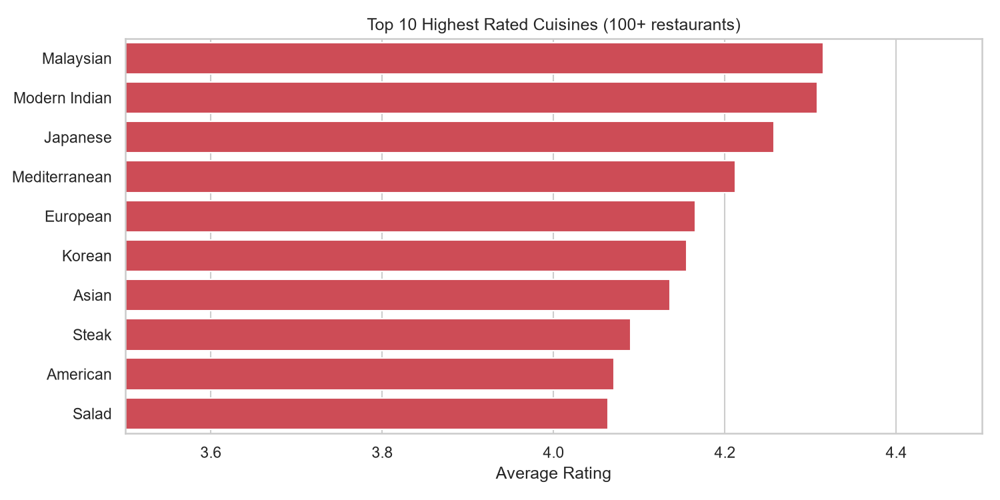
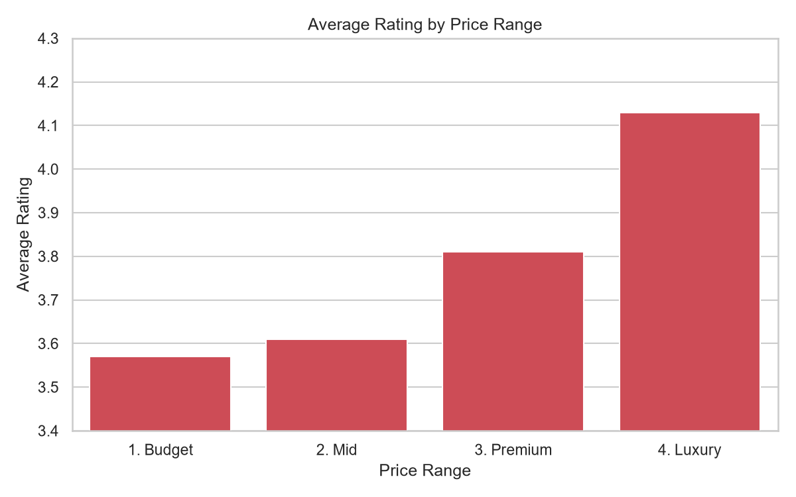
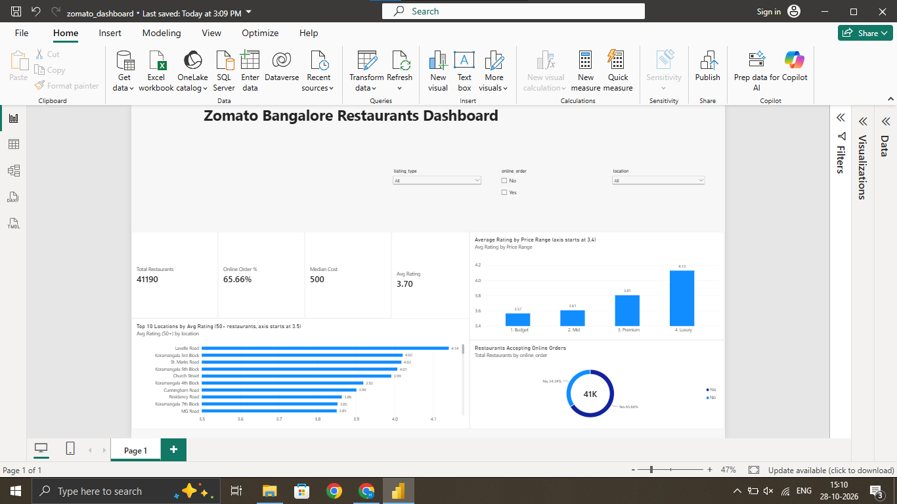

# Zomato Bangalore Restaurants Analysis

End-to-end data analytics project: **Python** (cleaning) → **MySQL** (analysis) → **Matplotlib / Seaborn** (charts) → **Power BI** (interactive dashboard).

## Objective
Find out what is linked to restaurant ratings in Bangalore: location, price, cuisine and online ordering.

## Dataset
[Zomato Bangalore Restaurants](https://www.kaggle.com/himanshupoddar/zomato-bangalore-restaurants) (Kaggle, by Himanshu Poddar)
- Raw data: 51,717 restaurants, 17 columns
- After cleaning: **41,190 restaurants, 11 columns**

## Tools
Python (Pandas, Matplotlib, Seaborn), MySQL, SQLAlchemy, Power BI (DAX), Jupyter Notebook, Git/GitHub

## Workflow
1. **Clean** the raw CSV in Python.
2. **Load** the cleaned data into a MySQL table (`restaurants`).
3. **Analyse** with SQL (GROUP BY, HAVING, CASE) and Pandas.
4. **Visualise** the findings with charts and document the insights.
5. **Build** an interactive Power BI dashboard on the cleaned data.

## Data Cleaning
- Dropped columns not needed for analysis: `url`, `address`, `phone`, `menu_item`, `reviews_list`, `dish_liked` (more than half of `dish_liked` was empty)
- Removed 108 duplicate rows and rows with missing values
- Removed 2,257 restaurants whose rating was `NEW` (2,192) or `-` (65)
- Converted `rate` (`"4.1/5"`) and cost (`"1,200"`) from text to numbers
- Fixed garbled restaurant names (text encoding errors such as `Café` → `Café`)
- Split the `cuisines` column (one cell held several cuisines) into one row per cuisine for cuisine analysis

## Key Insights
1. **Location:** Lavelle Road has the highest average rating (4.14). Four Koramangala blocks and central areas (St. Marks Road, Church Street, MG Road) fill the top 10. BTM has the most restaurants (3,873) but is not in the top 10, so more restaurants does not mean better ratings.
2. **Price:** Average rating rises with each price tier, from 3.57 (Budget, below ₹300) to 4.13 (Luxury, above ₹1,000). Mid-range (₹300-600) is the largest segment at about 51% of restaurants.
3. **Online ordering:** 66% of restaurants accept online orders. Their rating is almost the same as the rest (3.72 vs 3.66), but they are about 24% cheaper on average (₹545 vs ₹716 for two).
4. **Cuisine:** North Indian (17,180) and Chinese (12,834) are the most common. The highest-rated cuisines are Malaysian (4.32), Modern Indian (4.31) and Japanese (4.26), so popular does not mean best rated.

## Visuals




## Power BI Dashboard


Built on `zomato_cleaned.csv` with:
- **4 KPI cards:** total restaurants (41,190), average rating (3.70), median cost (₹500), online order share (65.66%)
- **Top 10 locations** by average rating (areas with 50+ restaurants only)
- **Average rating by price range** and an **online order** donut chart
- **Slicers** for location, listing type and online order, so every visual can be filtered
- A calculated column (`Price Range`) and DAX measures for the KPIs

Download `dashboard/zomato_dashboard.pbix` and open it in Power BI Desktop to explore it.

## Limitations
- The data covers **Bangalore only** and is a snapshot from a Kaggle dataset, so it may not reflect today's ratings.
- Results show **patterns, not causes**. For example, higher-priced restaurants rate higher, but price may not be the reason.
- Cuisine ranking includes only cuisines with 100+ restaurants. Small groups (such as Malaysian, 106 restaurants) are less reliable than large ones.
- Cuisine counts are mentions, so a restaurant serving 3 cuisines is counted 3 times.
- The axes of the best-cuisine, price and top-locations charts do not start at zero, to make differences visible. This makes gaps look larger than they are.

## Project Structure
```
zomato-bangalore-analysis/
├── data/        cleaned dataset and chart images
├── dashboard/   zomato_dashboard.pbix and dashboard.png
├── notebook/    analysis.ipynb (cleaning, SQL analysis, charts, insights)
├── sql/         zomato_queries.sql (commented queries)
└── README.md
```
The raw `zomato.csv` is not included because of its size. Download it from the Kaggle link above and place it in `data/` to re-run the notebook. Set your own MySQL password in the connection cell.
